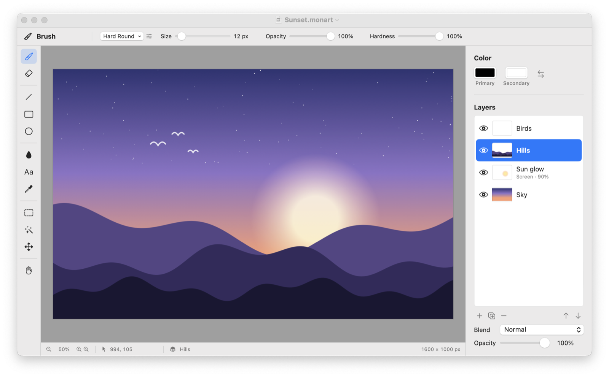

# Monart

A free, open-source paint app for macOS, built with SwiftUI and AppKit. It's made for
drawing with a trackpad or mouse: brushes, layers with blend modes, selections,
transforms, filters, and a native file format that keeps every layer.



## Download

**[Download the latest version](https://github.com/nhatientri/Monart/releases/latest)**
(`Monart-x.y.z.dmg`). Requires macOS 14 Sonoma or later, on Apple Silicon or Intel.

1. Open the disk image and drag **Monart** onto **Applications**.
2. Open Monart. The first time, macOS says it can't verify the developer. That's because
   Monart is free and isn't signed with a paid Apple Developer ID, not because anything
   is wrong. Click **Done**, then go to **System Settings ▸ Privacy & Security**, scroll
   down and click **Open Anyway**. You only need to do this once.

## Features

- **Brushes:** hard and soft round, square, calligraphy, marker, chalk, spray and scatter
  presets, with size, opacity and hardness. You can also turn a selection into a custom
  brush (Edit ▸ Define Brush from Selection).
- **Tools:** eraser, line, rectangle and ellipse (stroke or fill), paint bucket with
  tolerance, text, eyedropper (or hold ⌥ while painting) and hand.
- **Layers:** add, duplicate, reorder by dragging, rename by double-clicking, show or
  hide, set opacity, and choose from 16 blend modes (Multiply, Screen, Overlay…).
- **Selections:** rectangle, ellipse, lasso and magic wand. ⇧ adds, ⌥ subtracts,
  ⇧⌥ intersects. Painting, filters and copy/paste stay inside the selection.
- **Move and Free Transform (⌘T):** move, scale, stretch, rotate, or ⌘-drag a corner to
  distort and add perspective. Edges and centres snap to the canvas (hold ⌃ to place
  freely).
- **Images:** paste (⌘V) or drag in images from Finder, a browser or a screenshot. They
  arrive as a new layer, ready to transform.
- **Filters:** Invert, Grayscale, Brightness/Contrast, Hue/Saturation, Gaussian Blur, Sharpen,
  Pixelate and Posterize, with a live preview.
- **Canvas:** opens on a default canvas; Image ▸ Canvas Size… (⌥⌘C) scales or crops it
  and changes the background. Zooming and panning run on the GPU (pinch, ⌘-scroll,
  Space-drag).
- **Files:** the `.monart` format keeps layers, opacity and blend modes (drawings saved
  as `.canvas` by earlier versions still open). You can open
  PNG/JPEG files and export PNG/JPEG (⇧⌘E). Autosave and versions come from macOS.
- **Undo:** up to 50 steps (⌘Z / ⇧⌘Z).

## Requirements

- macOS 14 Sonoma or later
- Xcode 16 or later, to build it

## Build from source

To build an optimized copy and put it in `/Applications`:

```sh
scripts/install.sh          # build and install
scripts/build-release.sh    # only build build/Monart-<version>.dmg
```

To work on the code instead, open `Monart.xcodeproj` in Xcode and press **⌘R**. The Run
action uses the Release configuration, because the pixel code is several times faster
with optimizations on.

```sh
# Run the tests (145 unit tests)
xcodebuild test -project Monart.xcodeproj -scheme Monart -destination 'platform=macOS'
```

The Xcode project is generated from [`project.yml`](project.yml) by
[XcodeGen](https://github.com/yonaskolb/XcodeGen). After adding or removing source files,
regenerate it:

```sh
brew install xcodegen
xcodegen generate
```

## Keyboard shortcuts

| Tool | Key | | Action | Keys |
|---|---|---|---|---|
| Brush | B | | Swap colors | X |
| Eraser | E | | Brush size | [ ] |
| Line | L | | Free Transform | ⌘T |
| Rectangle | R | | Apply / cancel transform | Return / Esc |
| Ellipse | O | | Deselect / inverse | ⌘D / ⇧⌘I |
| Paint bucket | G | | New layer | ⇧⌘N |
| Text | T | | Canvas size | ⌥⌘C |
| Eyedropper | I | | Zoom in / out / fit / 100% | ⌘+ / ⌘− / ⌘0 / ⌘1 |
| Hand | H | | Pan from any tool | hold Space |
| Select / Magic wand / Move | M / W / V | | Snap on/off | ⇧⌘; |

## How it's built

```
Monart/
├── App/         app entry point, menus and commands
├── Document/    CanvasDocument (SwiftUI DocumentGroup) and the .monart package format
├── Model/       CanvasModel, layers, bitmaps, selections, brushes, editor state
├── Tools/       one class per tool, plus transform and snapping
├── Rendering/   canvas view (AppKit), compositor, stroke renderer, flood fill, filters
├── History/     undo: dirty-rect pixel snapshots and layer-stack changes
├── IO/          image import and export
└── UI/          SwiftUI panels: tools, options bar, colors, layers, status bar, sheets
```

- Each layer is an 8-bit premultiplied RGBA `CGContext` with a top-left origin. Tools
  only ever see canvas pixel coordinates.
- The canvas view flattens the layers into one image, updating only the areas that
  change, and shows it through Core Animation. The GPU does the zooming and panning.
  Selection outlines, previews and transform handles are drawn on a separate overlay.
- Undo stores only the changed rectangle of a layer (before and after), so most steps
  cost kilobytes, not a full copy of the layer.
- A `.monart` file is a package (a folder that Finder shows as one file): `manifest.json`,
  one PNG per layer in `layers/`, and a flattened `thumbnail.png`.

[`PLAN.md`](PLAN.md) has the full design notes and milestone history.

## Releasing a new version

1. Set `MARKETING_VERSION` in [`project.yml`](project.yml), for example `1.1.0`, then run
   `xcodegen generate` and commit.
2. Tag the commit and push the tag:

   ```sh
   git tag v1.1.0
   git push origin v1.1.0
   ```

GitHub Actions ([`release.yml`](.github/workflows/release.yml)) runs the tests, builds the
universal app and disk image, and publishes them as a GitHub Release. Every push to
`main` also runs the tests ([`ci.yml`](.github/workflows/ci.yml)).

## License

[MIT](LICENSE): free to use, change and share.
